# MixMarket

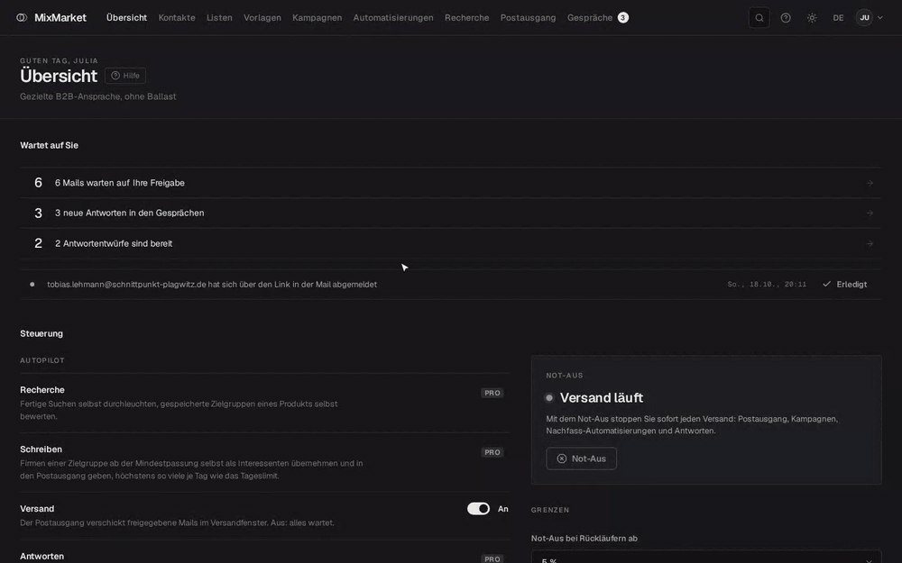

Rundgang mit erfundenen Beispieldaten · Walkthrough with invented sample data

[Deutsch](#deutsch) · [English](#english)

---

## Deutsch

MixMarket ist ein lokales Programm für gezielte B2B-Erstansprache. Es findet passende Firmen, liest deren Webseiten aus, bewertet sie mit KI für ein bestimmtes Produkt und schreibt persönliche Mails, die Sie vor dem Versand freigeben. Antworten landen im selben Programm. Mit MixMarket Pro werden sie zusätzlich eingeordnet und bekommen einen Antwortentwurf.

MixMarket läuft auf Ihrem eigenen Rechner. Die KI arbeitet über Ihr vorhandenes Claude- oder ChatGPT-Abo, ein API-Schlüssel ist nicht nötig.

### Funktionen

Alles in dieser Liste ist kostenlos:

- **Recherche:** Firmen nach Branche und Ort über OpenStreetMap finden, Webseiten durchleuchten (Ansprechpartner, Impressum, Merkmale), Zielgruppen über Merkmale zusammenstellen, KI-Bewertung je Produkt, Interessenten verwalten
- **Postausgang:** Die KI schreibt jede Mail einzeln und persönlich. Sie prüfen jede Mail und geben sie vor dem Versand frei. Auf Wunsch lässt sich die Freigabe je Produkt abschalten, Entwürfe mit Links auf fremde Seiten kommen dann trotzdem zur Prüfung. Dazu Versandfenster und Tageslimit
- **Gespräche:** Abruf des Postfachs, Zuordnung zu Interessenten, Erkennung von Rückläufern, Abwesenheitsnotizen und Abmeldungen, Antworten direkt aus MixMarket
- **Steuerung:** Übersicht „Wartet auf Sie“, Versand-Schalter, Not-Aus, automatischer Stopp bei zu vielen Rückläufern, KI-Pause bei knappem Abo-Kontingent, Auslastung
- **Klassisch:** Kontakte und Listen, Vorlagen mit Platzhaltern, Kampagnen, Sperrliste, Statistiken
- **Handbuch** in der App, Oberfläche auf Deutsch und Englisch, heller und dunkler Modus, auch auf dem Handy bedienbar

### MixMarket Pro

Pro nimmt Ihnen zusätzlich Arbeit ab. Das Abo kostet 10 € im Monat oder 100 € im Jahr, inklusive Steuer. Sie schließen es in MixMarket unter Einstellungen, „MixMarket Pro“ ab und schalten es dort mit Ihrem Schlüssel frei. Pro braucht eine Internetverbindung. Ohne Pro bleibt alles oben Genannte nutzbar.

- **Geführte Touren:** 22 Anleitungen, die Schritt für Schritt durch die App führen
- **Autopilot** für Recherche, Schreiben und Antworten
- **Nachfassen:** Nachfass-Mails im Postausgang und Nachfass-Automatisierungen für Kampagnen
- **„Alle freigeben“** im Postausgang
- **KI in Gesprächen:** Einordnung der Antworten und fertige Antwortentwürfe
- **Weitere Suchquellen:** DataForSEO und Serper
- **Vorlagenpakete** für sieben Branchen

| | |
| --- | --- |
| 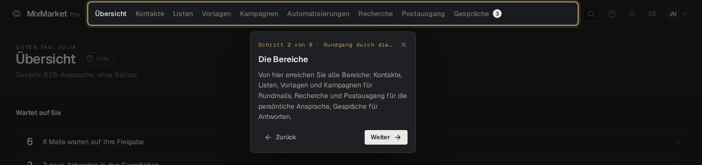 **Geführte Touren:** eine Sprechblase führt Schritt für Schritt durch die App | 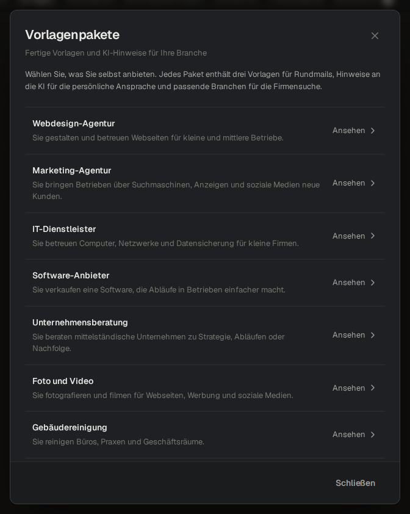 **Vorlagenpakete:** fertige Vorlagen für Ihr Angebot |
| 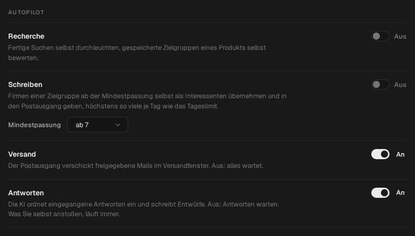 **Autopilot:** Recherche, Schreiben und Antworten laufen selbst | 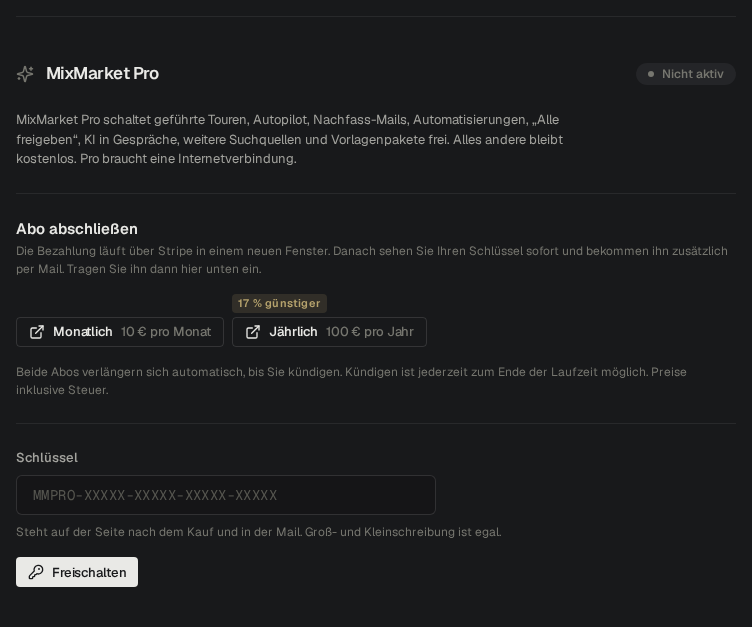 **Pro abschließen:** direkt in den Einstellungen, monatlich oder jährlich |

### So sieht MixMarket aus

Alle Bilder zeigen erfundene Beispieldaten.

| | |
| --- | --- |
| 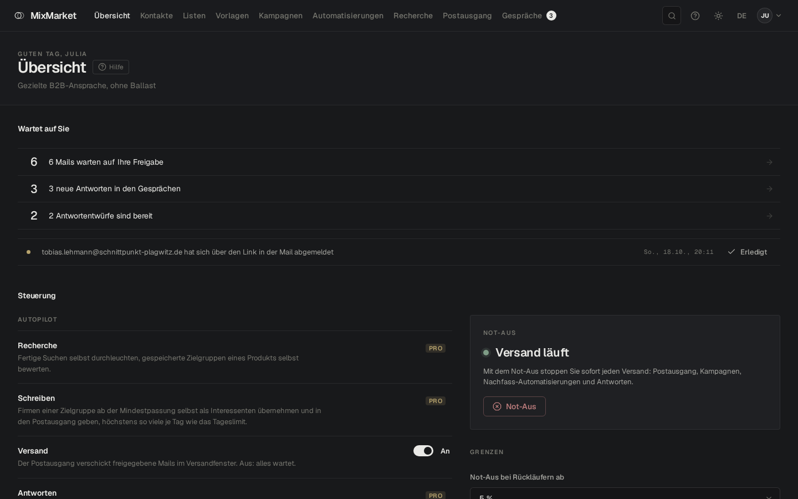 **Übersicht:** was auf Sie wartet, Autopilot und Not-Aus | 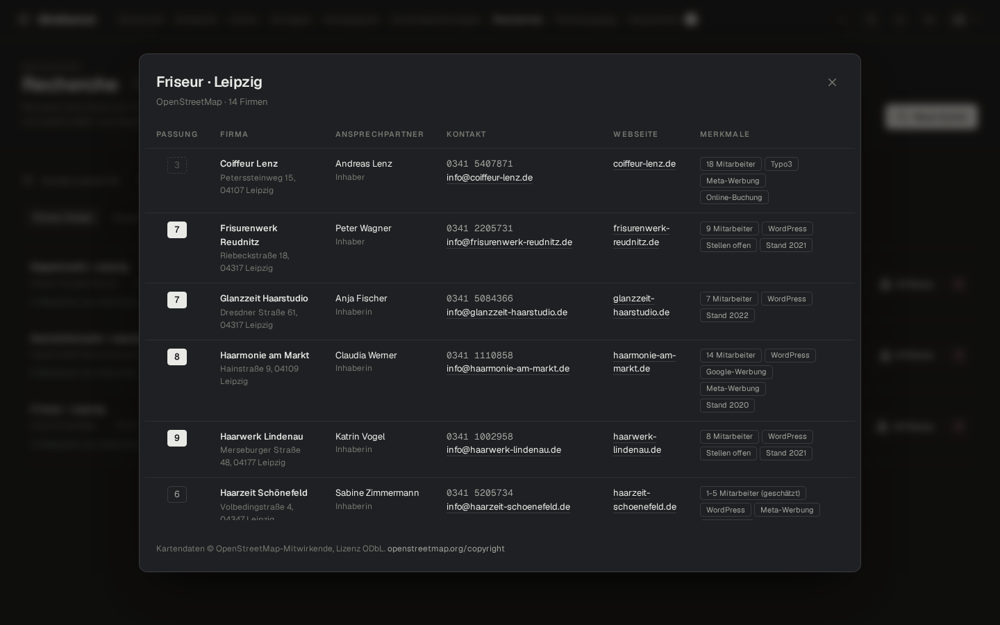 **Firmen finden:** Treffer mit Ansprechpartner, Kontakt, Merkmalen und KI-Passung |
| 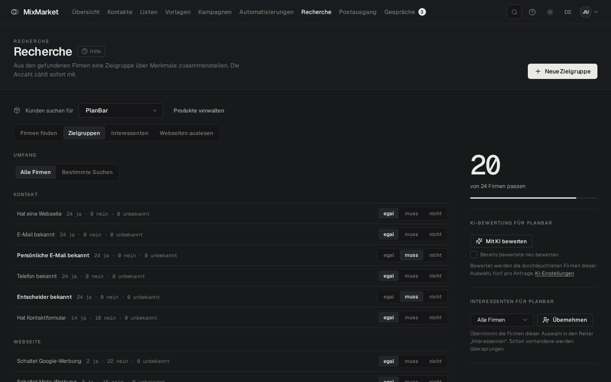 **Zielgruppe:** Merkmale wählen, die Anzahl zählt sofort mit | 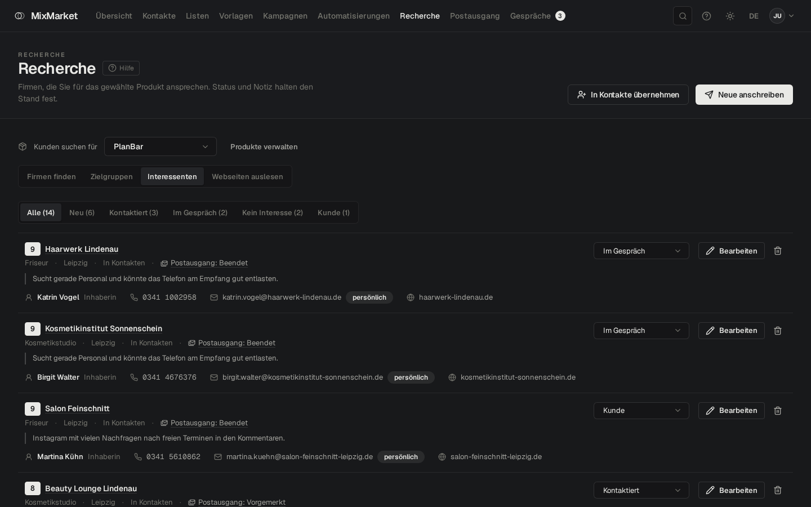 **Interessenten:** Status, Ansprechpartner und Stand der Ansprache je Firma |
| 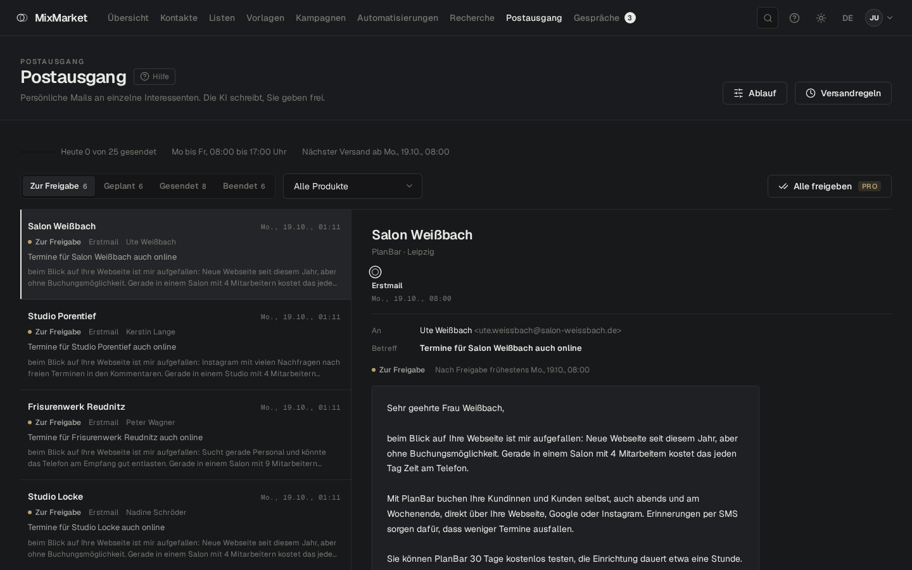 **Postausgang:** persönliche Mails der KI prüfen und freigeben | 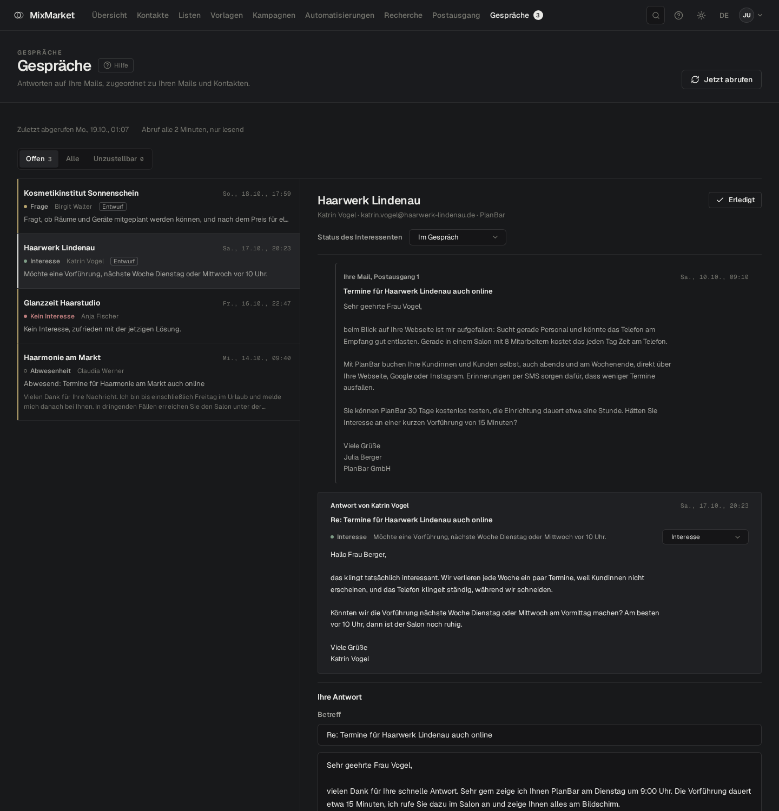 **Gespräche:** Antworten lesen und beantworten, mit Pro eingeordnet und mit Entwurf |
| 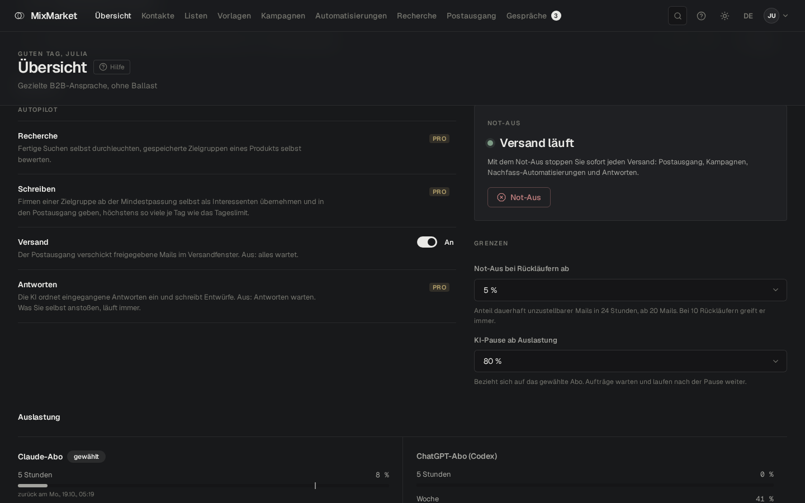 **Steuerung:** Versand, Not-Aus, Grenzen und Auslastung, mit Pro Autopilot je Bereich | 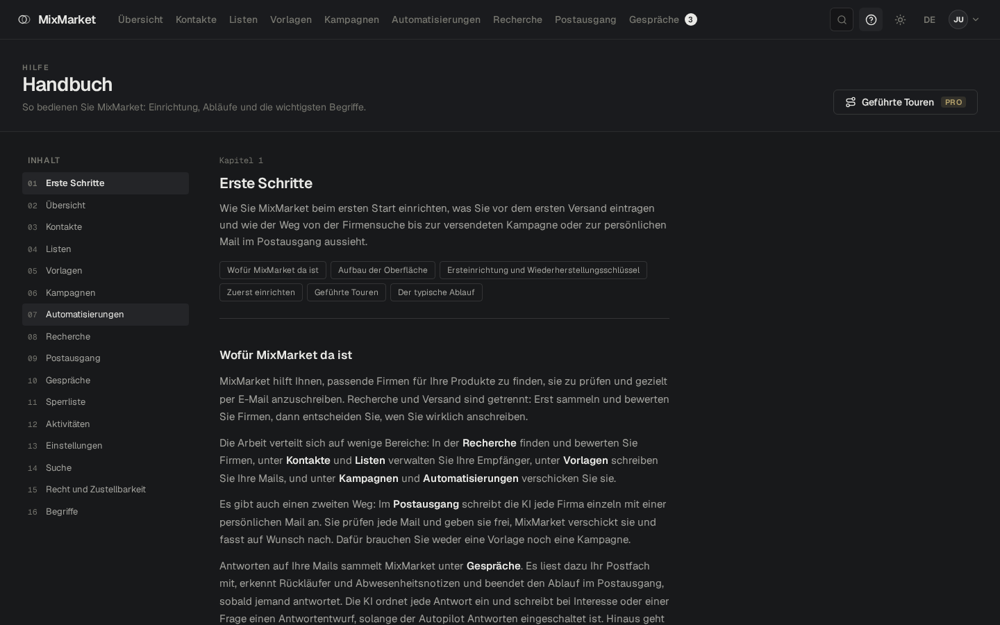 **Handbuch:** jede Funktion erklärt, direkt in der App |

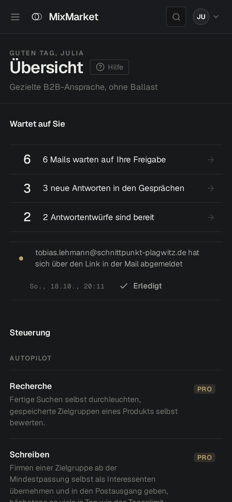&nbsp;&nbsp;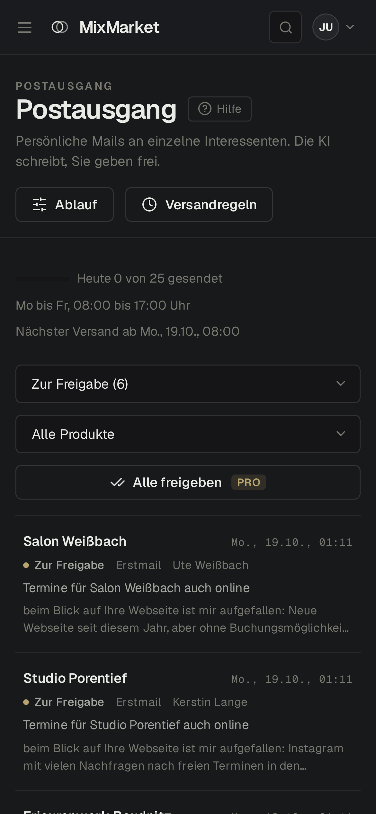

### Voraussetzungen

- Für die KI-Funktionen: [Claude Code](https://claude.com/claude-code) (`claude`) oder die Codex CLI (`codex`), installiert und angemeldet
- Für echten Versand und Empfang: ein Postfach mit SMTP und IMAP. Ohne Postfach läuft MixMarket im Testmodus und verschickt nichts.
- Optional mit MixMarket Pro: Zugänge zu DataForSEO und Serper als weitere Suchquellen (werden in der App eingetragen)

### Installation

Die Installationspakete stehen unter [Releases](https://github.com/noosmedia/MixMarket/releases/latest):

| System | Datei |
| --- | --- |
| Windows | `MixMarket-Setup-<Version>.exe` |
| macOS mit Apple-Chip | `MixMarket-<Version>-arm64.dmg` |
| macOS mit Intel-Prozessor | `MixMarket-<Version>-x64.dmg` |
| Linux (Ubuntu, Debian, Mint) | `MixMarket-<Version>-amd64.deb` |
| Linux (Fedora, openSUSE) | `MixMarket-<Version>-x86_64.rpm` |
| Linux (alle) | `MixMarket-<Version>-x86_64.AppImage` |

Nach der Installation steht MixMarket mit seinem Symbol im Startmenü (unter macOS im Ordner „Programme“). Ein Klick startet es in einem eigenen Fenster. Beim ersten Start legen Sie Ihr Konto an.

Die Pakete sind nicht mit einem kostenpflichtigen Zertifikat signiert. Deshalb fragt das System beim ersten Start nach:

- **Windows:** Erscheint „Der Computer wurde durch Windows geschützt“, klicken Sie auf **Weitere Informationen** und dann auf **Trotzdem ausführen**.
- **macOS:** Öffnen Sie MixMarket einmal, schließen Sie den Hinweis und wählen Sie unter **Systemeinstellungen**, **Datenschutz & Sicherheit** den Knopf **Dennoch öffnen**.
- **Linux (AppImage):** Datei ausführbar machen (Rechtsklick, Eigenschaften, Rechte) und starten. MixMarket trägt sich dabei selbst ins Startmenü ein. Manche Systeme brauchen dafür das Paket `libfuse2`.

Ihre Daten (Datenbank, Einstellungen, Protokoll) liegen im Benutzerordner und bleiben bei Updates und beim Deinstallieren erhalten:

- Windows: `%APPDATA%\MixMarket`
- macOS: `~/Library/Application Support/MixMarket`
- Linux: `~/.config/MixMarket`

Sind Passwort und Wiederherstellungsschlüssel verloren, setzen Sie das Passwort im Programm auf der Seite „Passwort vergessen“ neu, nur an diesem Rechner. Wie das geht, steht im Handbuch unter „Passwort vergessen“.

### Aktualisieren

Gibt es eine neue Version, zeigt MixMarket oben rechts einen kleinen Punkt an Ihren Initialen und im Menü **Update verfügbar**.

Im Fenster **Update verfügbar** auf **Jetzt aktualisieren** klicken. MixMarket lädt die neue Version, sichert vorher die Datenbank und startet neu. Ihre Daten bleiben erhalten. Unter Linux mit .deb oder .rpm fragt das System dabei nach Ihrem Passwort. Unter macOS führt der Knopf zur Download-Seite: neue `.dmg` öffnen und MixMarket wieder in „Programme“ ziehen.

### Aufbau

| Ordner | Inhalt | Port |
| --- | --- | --- |
| `server/` | Backend: Node.js, TypeScript, Fastify, Prisma 7 mit SQLite | 5260 |
| `web/` | Oberfläche: React 19, Vite, TypeScript, i18next | 5261 |
| `desktop/` | Programm: Electron-Fenster um Server und Oberfläche, Installationspakete, Updates | 5268 |

### Lizenz

Der Quellcode von MixMarket steht unter der GNU Affero General Public License 3.0 (AGPL-3.0), siehe [LICENSE](LICENSE). MixMarket Pro gehört nicht zu diesem Repository.

---

## English

MixMarket is a local application for targeted B2B outreach. It finds suitable companies, reads their websites, rates them with AI for a specific product and writes personal emails that you approve before they are sent. Replies arrive in the same application. With MixMarket Pro they are also classified and get a draft answer.

MixMarket runs on your own computer. The AI works through your existing Claude or ChatGPT subscription, no API key is required.

### Features

Everything in this list is free:

- **Research:** find companies by industry and location via OpenStreetMap, analyse websites (contacts, legal notice, characteristics), build target groups from characteristics, AI rating per product, manage prospects
- **Outbox:** AI writes every email individually and personally. You review every email and approve it before it is sent. Approval can be switched off per product; drafts with links to other websites still come to you for review. Plus sending windows and a daily limit
- **Conversations:** mailbox polling, matching to prospects, detection of bounces, out-of-office replies and unsubscribes, replying directly from MixMarket
- **Control:** "Waiting for you" overview, sending switch, emergency stop, automatic stop on too many bounces, AI pause when the subscription quota runs low, usage
- **Classic:** contacts and lists, templates with placeholders, campaigns, suppression list, statistics
- **Built-in handbook**, interface in German and English, light and dark mode, also usable on a phone

### MixMarket Pro

Pro takes even more work off your hands. The subscription costs €10 per month or €100 per year, tax included. You subscribe in MixMarket under Settings, "MixMarket Pro" and unlock it there with your key. Pro needs an internet connection. Without Pro, everything listed above stays available.

- **Guided tours:** 22 step-by-step walkthroughs inside the app
- **Autopilot** for research, writing and replies
- **Follow-ups:** follow-up emails in the Outbox and follow-up automations for campaigns
- **"Approve all"** in the Outbox
- **AI in Conversations:** classification of replies and ready draft answers
- **More search sources:** DataForSEO and Serper
- **Template packs** for seven industries

| | |
| --- | --- |
|  **Guided tours:** a speech bubble takes you through the app step by step |  **Template packs:** ready-made templates for what you offer |
|  **Autopilot:** research, writing and replies run by themselves |  **Subscribe to Pro:** right in the settings, monthly or yearly |

### Screenshots

All images show invented sample data and the German interface; English can be selected in the app.

| | |
| --- | --- |
|  **Overview:** what is waiting for you, autopilot and emergency stop |  **Find companies:** results with contact person, contact details, characteristics and AI fit |
|  **Target group:** pick characteristics, the count updates instantly |  **Prospects:** status, contact person and outreach progress per company |
|  **Outbox:** review and approve personal AI emails |  **Conversations:** read and answer replies, with Pro classified and with a draft |
|  **Control:** sending, emergency stop, limits and usage, with Pro autopilot per area |  **Handbook:** every feature explained, right inside the app |

&nbsp;&nbsp;

### Requirements

- For the AI features: [Claude Code](https://claude.com/claude-code) (`claude`) or the Codex CLI (`codex`), installed and signed in
- For real sending and receiving: a mailbox with SMTP and IMAP. Without a mailbox MixMarket runs in test mode and sends nothing.
- Optional with MixMarket Pro: DataForSEO and Serper accounts as additional search sources (entered in the app)

### Installation

The installers are available under [Releases](https://github.com/noosmedia/MixMarket/releases/latest):

| System | File |
| --- | --- |
| Windows | `MixMarket-Setup-<version>.exe` |
| macOS with Apple chip | `MixMarket-<version>-arm64.dmg` |
| macOS with Intel processor | `MixMarket-<version>-x64.dmg` |
| Linux (Ubuntu, Debian, Mint) | `MixMarket-<version>-amd64.deb` |
| Linux (Fedora, openSUSE) | `MixMarket-<version>-x86_64.rpm` |
| Linux (all) | `MixMarket-<version>-x86_64.AppImage` |

After installing, MixMarket appears with its icon in the start menu (on macOS in the Applications folder). One click opens it in its own window. On the first start you create your account.

The installers are not signed with a paid certificate, so the system asks on the first start:

- **Windows:** If "Windows protected your PC" appears, click **More info** and then **Run anyway**.
- **macOS:** Open MixMarket once, close the notice and choose **Open Anyway** under **System Settings**, **Privacy & Security**.
- **Linux (AppImage):** Make the file executable (right click, Properties, Permissions) and start it. MixMarket adds itself to the start menu. Some systems need the `libfuse2` package for this.

Your data (database, settings, log) lives in your user folder and is kept on updates and when uninstalling:

- Windows: `%APPDATA%\MixMarket`
- macOS: `~/Library/Application Support/MixMarket`
- Linux: `~/.config/MixMarket`

If both password and recovery key are lost, set a new password in the program on the Forgot password page, only on this computer. The handbook explains how under "Forgot password".

### Updating

When a new version is out, MixMarket shows a small dot on your initials at the top right and **Update available** in the menu.

In the **Update available** window click **Update now**. MixMarket downloads the new version, backs up the database first and restarts. Your data is kept. On Linux with .deb or .rpm the system asks for your password. On macOS the button leads to the download page: open the new `.dmg` and drag MixMarket into Applications again.

### Structure

| Folder | Content | Port |
| --- | --- | --- |
| `server/` | Backend: Node.js, TypeScript, Fastify, Prisma 7 with SQLite | 5260 |
| `web/` | Interface: React 19, Vite, TypeScript, i18next | 5261 |
| `desktop/` | App: Electron window around server and interface, installers, updates | 5268 |

### License

The source code of MixMarket is licensed under the GNU Affero General Public License 3.0 (AGPL-3.0), see [LICENSE](LICENSE). MixMarket Pro is not part of this repository.
